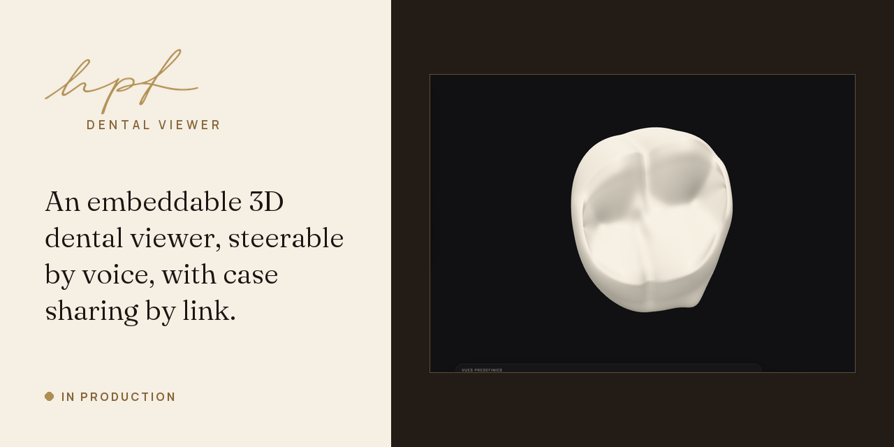
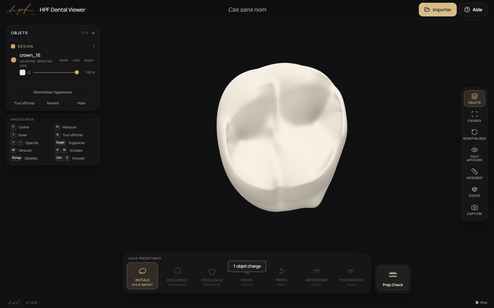
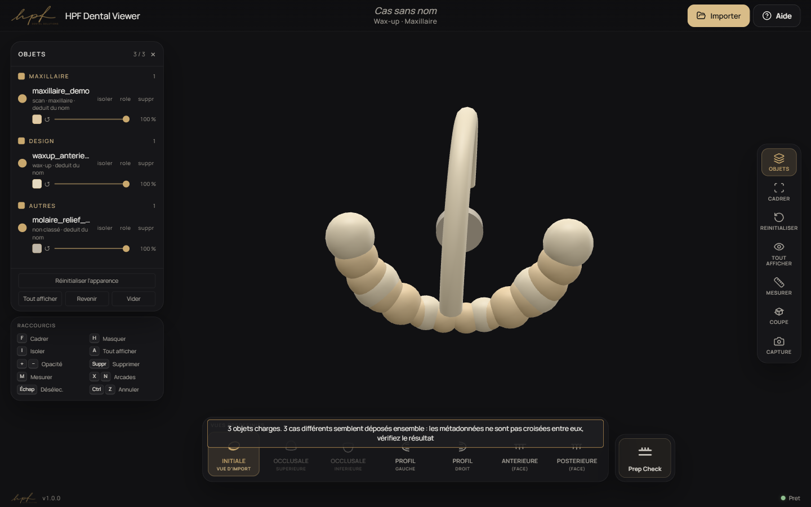
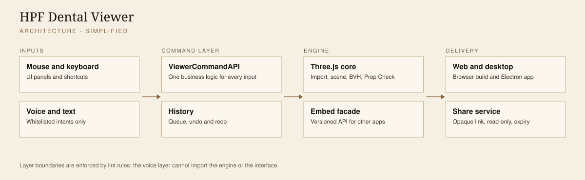

# HPF Dental Viewer

> An embeddable 3D dental viewer, steerable by voice, with case sharing by simple link.

**Status** · In production &nbsp;·&nbsp; **Area** · Digital Dentistry & CAD/CAM &nbsp;·&nbsp; **Source code** · private, documentation only

### At a glance

- Open a 3D case in a browser, on the desktop or inside another app.
- Steer the view by voice, in French, with whitelisted commands.
- Share a case by link, read-only, revocable.

## The problem

CAD software exports cases in closed viewers that are hard to brand, to embed or to share cleanly with a practitioner.  
Sharing a 3D case often means a file attachment that opens badly on a phone.  

## The solution

A 3D case viewer controlled by mouse, keyboard or voice, that runs in the browser, on the desktop or inside other applications, and shares a case through a read-only link.

## My role

Product design and development.  
The project started from sharing and reviewing 3D designs with practitioners.

## Key features

- Imports PLY with vertex colours, STL, OBJ, glTF, DCM and CAD HTML exports.
- Seven clinical views, per-object visibility, isolation, opacity and colour, with undo and redo.
- Reads the technical metadata of a CAD project: teeth (FDI), orientation, prescribed shade.
- Prep Check: scalar map on a surface with filter, isoline and statistics.
- Measurement, clipping plane and labels.
- French voice and text commands with an offline speech model.
- Embeddable engine package with a versioned API, used inside HPF Communicate.
- Windows desktop application and read-only share links.

## Screenshots

All screenshots use demonstration or synthetic data.

Synthetic crown generated by the HPF Morphology Engine

Synthetic test case with the object panel

## Technologies

TypeScript · Three.js · three-mesh-bvh · Vite · Vitest · Electron · Vosk · Netlify Functions

## Architecture

- Every action, whatever its source, goes through a single command API; voice only emits structured commands validated against a whitelist, never code.
- Shared CAD exports are parsed as data and never executed.
- No invented clinical analysis: contacts or thickness are shown only if the case data contains them.

## Development status

- Case sharing service in production for practitioners.
- Windows desktop application 1.0.0.
- Engine 1.16.0 release candidate: 2,146 tests passing across 140 files; embedding API versioned up to 1.18.
- iPhone: works as a web app; a native shell is a feasibility study only.

## Privacy and code availability

- Case files stay local unless explicitly shared.
- Share links use random opaque identifiers, with no listing endpoint, revocation and optional expiry.
- No personal data in the share index; production builds strip source maps and console output.
- The desktop app grants the microphone permission only.
- The source code of HPF Dental Viewer is proprietary and kept in a private repository.
- This repository contains documentation and demonstration screenshots only.
- Demonstrations can be arranged on request.

---

[Hugo Philippe Fusaro](https://github.com/hugophilippefusaro) · [HPF Dental Solutions](https://github.com/hpfdentalsolutions) · [hpfdentalsolutions.com](https://hpfdentalsolutions.com)  
© 2026 Hugo Philippe Fusaro. All rights reserved on texts and images.
